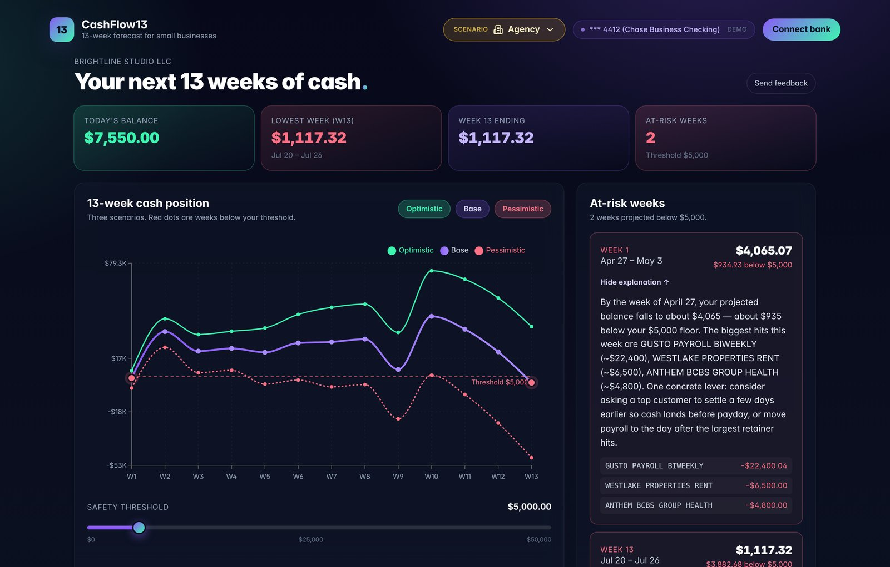

# CashFlow13

> A 13-week cash-flow forecast for small businesses: see which weeks dip below your safety floor, and why, in plain English.

**Live demo:** [cash-flow13.vercel.app](https://cash-flow13.vercel.app) · **Deeper reads:** [CASE_STUDY.md](./CASE_STUDY.md) · [OPERATIONS.md](./OPERATIONS.md) · [ROADMAP.md](./ROADMAP.md) · [CHANGELOG.md](./CHANGELOG.md)

> **Portfolio project on mock data.** Every business, transaction and bank account in the demo is fictional and generated by `scripts/seed-scenarios.ts`. There are no real users or customers, and the app does not move or store money.



---

## 1. The problem and the user

**Problem.** Small-business owners know today's bank balance but rarely know what it will be in six weeks. A quarterly tax payment landing in the same week as payroll and an annual insurance premium can turn into a surprise shortfall. Larger companies prevent this with a 13-week rolling cash forecast; owner-operated businesses usually don't have one.

**Target user.** The owner-operator of a US service or retail business (roughly 5–25 employees) who reviews finances once a week. Financially aware, not a trained accountant, short on time.

**Job to be done.** "On Monday morning, tell me which upcoming weeks are tight, what's causing it, and one thing I can do about it."

**Success measures (defined, not yet measured — there are no real users).** North star: weekly forecasts viewed (`forecast_viewed` event). Guardrails: forecast accuracy on the eval set, and zero explanations that cite a transaction not in the data.

---

## 2. What the demo does today

1. **Three mock businesses**, switchable from the **Scenario** dropdown: *Agency* (lumpy client retainers), *Retail* (daily card payouts, inventory spend), *Tax Crisis* (modest balance, large federal tax payment ahead).
2. **13-week forecast in three scenarios** (optimistic / base / pessimistic), drawn as a chart. Weeks where the base balance falls below the threshold get a red dot.
3. **Threshold slider.** Drag the safety floor; the forecast and the at-risk list recompute in the browser instantly.
4. **"Why is this happening?"** Each at-risk week expands to a plain-English explanation that names the biggest outflows by their bank description, lists them with amounts, and suggests one concrete action.
5. **Connect bank.** Opens the real Plaid sandbox login when Plaid keys are configured (or skips straight ahead when they aren't), plays a short progress animation, then loads the Retail scenario. No bank data is fetched or used — see the "front door" decision below.
6. **Feedback + event tracking.** A *Send feedback* box and a small `track()` shim that logs product events to the console (ready to forward to an analytics tool).

What it does **not** do yet: call an LLM, fetch real transactions, persist anything, or support accounts. Those are in [ROADMAP.md](./ROADMAP.md).

---

## 3. How it works

```
scripts/seed-scenarios.ts ──► data/scenarios/{agency,retail,tax-crisis}.json
  generate mock transactions          (transactions + categories + forecast
  → categorize with rules             + explanations, committed to the repo)
  → lib/forecast.ts                                  │
  → template explanations                            ▼
  → lib/guardrail.ts (abort on bad citation)   app/page.tsx loads bundles
                                                     │
                                                     ▼
                                    components/Dashboard.tsx (client)
                                    re-runs lib/forecast.ts when the
                                    threshold changes; chart via Recharts
```

- **Categorization** — a deterministic rule list in `scripts/seed-scenarios.ts` labels each transaction (payroll, rent, tax, subscriptions, vendor payment, …) and marks it recurring or not.
- **Forecast engine** — `lib/forecast.ts` (pure TypeScript, no dependencies) groups recurring transactions into streams, infers each stream's cadence from the median gap between dates (weekly, biweekly, monthly, quarterly, annual), projects them 13 weeks forward, buckets them by week, and rolls the balance forward. Optimistic = revenue ×1.10, costs ×0.95; pessimistic = revenue ×0.90, costs ×1.10.
- **Explanations** — template-generated from each at-risk week's top three outflows, so every vendor name is copied from the data, never written freely.
- **Citation guardrail** — `lib/guardrail.ts` checks that every cited transaction id exists and that every ALL-CAPS vendor phrase in an explanation appears in a real transaction description. The seed script refuses to write a bundle that fails, and `npm run verify:citations` re-checks the committed bundles.
- **Eval** — `eval/run-eval.ts` runs six hand-built cases with known ground truth and reports how many forecast weeks land within ±$200.

---

## 4. Key decisions and trade-offs

**1. "Real front door, pre-computed behind it."** A live pipeline (Plaid transaction sync, then categorization, then explanations) would risk timeouts on Vercel's free tier, and a reviewer scanning the demo for 90 seconds would see a broken page. So every interaction after load runs in the browser on pre-computed mock data. *Cost:* the demo doesn't prove a live bank integration. *Mitigation:* the UI and this README say so plainly.

**2. Templates before an LLM for explanations.** The riskiest failure in a finance tool is a confident explanation that names a bill the owner doesn't have. Templates make that impossible by construction, and the citation guardrail makes the rule enforceable for any future LLM-written version. *Cost:* explanations are formulaic. An LLM-written version, gated by the same guardrail, is on the roadmap.

**3. Conservative projection.** Only streams with enough history are projected (≥2 occurrences for annual, ≥3 for monthly and quarterly, ≥4 for biweekly, ≥6 for weekly). One-off spikes are never extrapolated. *Cost:* lower recall — some real obligations are missed. *Why:* a forecast that warns about a bill that never comes loses the owner's trust faster than one that misses an irregular payment.

**4. Three scenarios, not one number.** Owners plan around "how bad can it get", so the pessimistic line matters as much as the base. *Cost:* a busier chart; each line can be toggled off.

**5. One Next.js project, pure-TypeScript engine.** One language, one deploy, no backend to keep alive. The forecast engine has no framework imports, so the same code runs in the seed script, the eval, and the browser.

**Known limitation (kept visible on purpose).** Eval case 6 fails on its own: IRS estimated taxes are due on fixed calendar dates, but the engine models them as "every ~91 days", so it projects the payment about a month late. Measured this run: **94.9% of weeks within ±$200 overall (74/78), case 6 at 69.2%**. Fixing calendar-anchored cadences is the top item in [ROADMAP.md](./ROADMAP.md).

---

## 5. Run it locally

Requires Node 18.17+. No API keys or environment variables are needed.

```bash
npm install
npm run dev                # http://localhost:3000
npm run eval               # forecast-accuracy harness (6 cases)
npm run verify:citations   # citation guardrail over the shipped scenario bundles
npm run seed               # regenerate data/scenarios/*.json (runs the guardrail)
npm run build              # production build
```

Optional: to see the real Plaid sandbox login when clicking *Connect bank*, copy `.env.example` to `.env.local` and add Plaid sandbox keys (`PLAID_CLIENT_ID`, `PLAID_SECRET`, `PLAID_ENV=sandbox`). Sandbox credentials are `user_good` / `pass_good`. Without keys, the button skips the modal and goes straight to the progress animation.

**Try the guardrail.** In `data/scenarios/agency.json`, change `WESTLAKE PROPERTIES RENT (~` inside an explanation to `WESTPACK PROPERTIES RENT (~`, then run `npm run verify:citations`:

```
✗ agency
CITATION GUARDRAIL FAILED:
  week 1: cited "WESTPACK PROPERTIES RENT" not found in any transaction
```

The command exits non-zero. Revert the edit with `git checkout data/`.

---

## 6. Tech stack

| Layer | Choice | Why |
|---|---|---|
| App | Next.js 14 (App Router) + TypeScript | One deployable, server-side load of the scenario bundles, client-side interactivity |
| Chart | Recharts | Multi-line chart with custom dots and tooltips |
| Styling | Tailwind CSS, lucide-react icons | Fast, consistent UI |
| Bank login | Plaid Link (sandbox), optional | Shows the real connection flow without handling real bank data |
| Hosting | Vercel (Hobby) | Deploys from `main` |

---

## Repository map

- `lib/forecast.ts` — forecasting engine (cadence detection, 13-week projection, 3 scenarios, at-risk flagging)
- `lib/guardrail.ts` — citation guardrail for explanations
- `scripts/seed-scenarios.ts` — generates the three mock scenario bundles
- `scripts/verify-citations.ts` — runs the guardrail over the committed bundles
- `data/scenarios/*.json` — pre-computed Agency / Retail / Tax Crisis bundles
- `eval/` — six-case forecast accuracy harness
- `components/` — dashboard, chart, scenario switcher, Plaid launcher, progress animation
- [CASE_STUDY.md](./CASE_STUDY.md) · [OPERATIONS.md](./OPERATIONS.md) · [ROADMAP.md](./ROADMAP.md) · [CHANGELOG.md](./CHANGELOG.md) · [LOOM_SCRIPT.md](./LOOM_SCRIPT.md)

License: MIT
